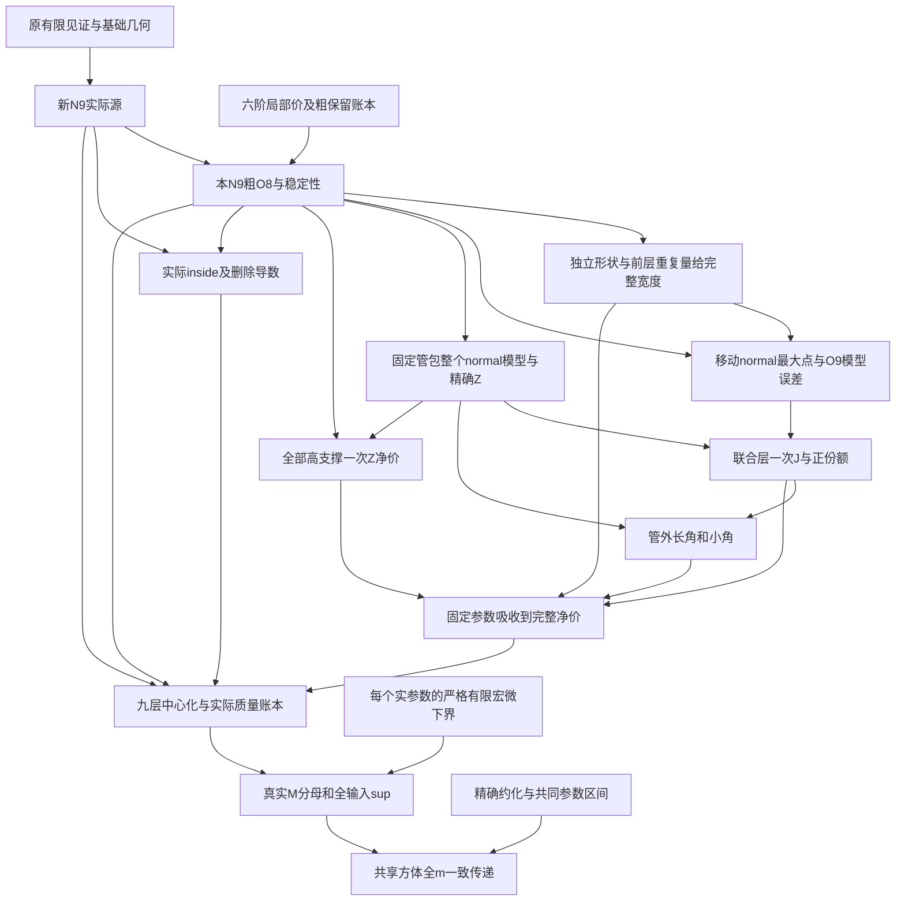

# 当前正式正文的语义依赖入口

第68轮最终七源身份`42eead43fe9e13ca26d0ea30aa6165c1e845c3dfac006d5a64c7107f8ad63647`。当前[12节点JSON](068-dependencies.json)逐项给假设、量词、误差、实际供货和范围；[完整数学重构](../reviews/068-paper-math-audit.md)解释每个箭头，不以审查状态当引理。

Q编号只作本证据入口，不代替正文标签。Q01–Q12的实际锚点见JSON；原基础/六阶/粗八阶的更细推导仍见第63轮冻结重构。新正文删去的旧精确N8总装并不充当Q12的输入。第63轮51节点与初始版本对照继续保留为历史回源证据，行号不自动迁移到73页版。
